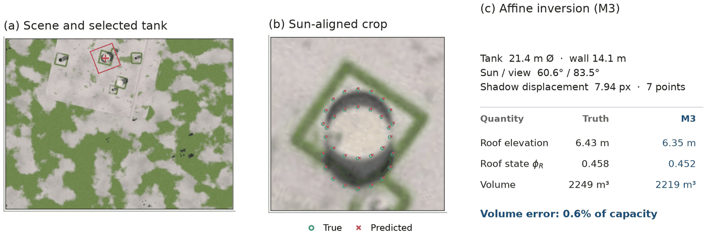
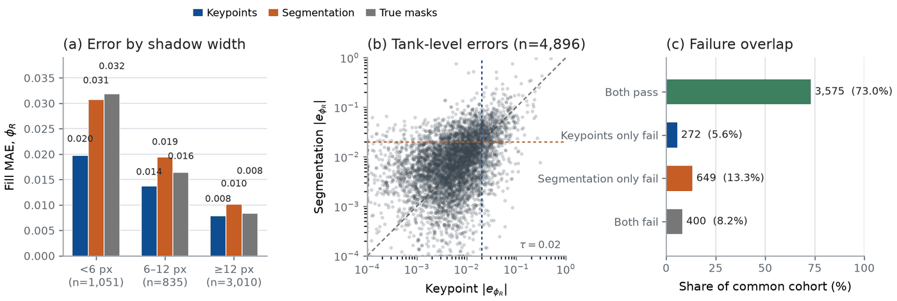

<div align="center">

# SynTank-25k 🛢️

### Points, Not Pixels: Keypoints, Masks and Oblique Geometry for Floating-Roof Tank Fill Estimation from Overhead Imagery

**Accepted at the WACV 2027 Workshop on Computer Vision for Earth Observation Applications (CV4EO)**

[](https://arxiv.org/abs/2611.27624)
[](https://doi.org/10.5281/zenodo.24395104)
[](https://www.python.org/)
[](https://pytorch.org/)

</div>



## Preprints

- arXiv: [Points, Not Pixels: Keypoints, Masks and Oblique Geometry for Floating-Roof Tank Fill Estimation from Overhead Imagery](https://arxiv.org/abs/2611.27624)
- Dataset: [SynTank-25k on Zenodo](https://doi.org/10.5281/zenodo.24395104)

## 🔍 Overview

The floating roof of an oil storage tank rests on the stored liquid, so its depth below the rim tells how full the
tank is. In overhead imagery this depth shows up only as the crescent shadow the rim casts on the roof, often a few
pixels wide. We predict the rim and shadow boundaries as **65 sub-pixel keypoints** and invert the shadow geometry
with a **local affine (oblique) camera model** (M3), alongside a metadata-free shadow ratio (M1) and the classical
nadir formula (M2). We compare this with a **segmentation** pipeline that feeds predicted shadow masks into the same
geometry, and train on **SynTank-25k**: 24,987 physically based Blender renders with exact roof, shadow and camera
geometry.

## Performance on SynTank-25k



Fill error (MAE of the roof state φ_R) on the SynTank-25k test set, mean ± s.d. over four seeds:

| Pipeline | M3 (oblique) | M1 (no metadata) | M2 (nadir) |
|---|---|---|---|
| Keypoints (ResNet-18) | **0.0128 ± 0.0005** | **0.0160 ± 0.0003** | 0.093 ± 0.001 |
| Segmentation (MobileNetV3 U-Net) | 0.0164 ± 0.0005 | 0.095 ± 0.013 | 0.077 ± 0.001 |

See the [paper](https://arxiv.org/abs/2611.27624) for coverage, matched cohorts, the oblique-view analysis and the real NAIP results.

## ⚙ Requirements

### Installation

Tested with Python 3.12, PyTorch 2.5.1 and CUDA 11.8.

```bash
pip install torch==2.5.1 torchvision==0.20.1 --index-url https://download.pytorch.org/whl/cu118
pip install -r requirements.txt
```

Rendering new synthetic data (optional) needs [Blender](https://www.blender.org/) ≥ 4.2 on the `PATH`.

## 📊 Datasets & Preprocessing

### Data Preparation

**SynTank-25k** is on Zenodo: [10.5281/zenodo.24395104](https://doi.org/10.5281/zenodo.24395104). Unzip all
archives into `data/`, then add the two index files the scripts read (per-folder `metadata.json` and the paper's
split as `shared_split.json`):

```bash
for f in SynTank-25k_*.zip; do unzip -q "$f" -d data; done
python synthetic_data/from_zenodo.py --data data/SynTank-25k
```

**Real NAIP tanks** (detection and the real-image analysis only) come from the above-ground storage tank dataset of
Robinson et al. (2024). Put its `images/`, `xmls/`, `image_characteristics.csv` and `tank_inventory.json` in
`data/` (`python download_dataset.py` downloads them).

```
data/
  SynTank-25k/        images/ masks/ labels/ metadata/ shared_split.json
  images/ xmls/ image_characteristics.csv tank_inventory.json      (real NAIP)
```

## 🚀 Running the Code

Commands are run from the repository root. `${seed}` is 0–3 in the paper.

### ✂️ Preprocess: Keypoint and Segmentation Crops

```bash
python keypoint/prepare_synthetic_kp.py --src data/SynTank-25k --out data/keypoint_data \
    --split-file data/SynTank-25k/shared_split.json
python segmentation/prepare_synthetic_seg.py --src data/SynTank-25k --split-dir data/keypoint_data \
    --out data/segmentation_data
python synthetic_data/audit_syn_split.py --merged data/SynTank-25k --split-file data/SynTank-25k/shared_split.json \
    --kp data/keypoint_data --seg data/segmentation_data --out data/leakage_audit.json
```

### 🎯 Keypoints (Training, Evaluation, Fill M1/M2/M3)

```bash
python keypoint/train.py --config keypoint/config.yaml data=data/keypoint_data name=kp_r18_s${seed} seed=${seed}
python keypoint/evaluate.py --run runs/keypoint/kp_r18_s${seed} --split test --data data/keypoint_data
python keypoint/calc_handoff.py --run runs/keypoint/kp_r18_s${seed} --data data/keypoint_data \
    --labels data/SynTank-25k/labels
```

`calc_handoff.py` writes per-tank fill, roof height and volume for M1, M2 and M3 to `<run>/calc_handoff/`.
`keypoint/failure_groups.py --run runs/keypoint/kp_r18_s0 --data data/keypoint_data` clusters the failures.

### 🧩 Segmentation (Training, Evaluation, Fill)

```bash
python segmentation/train_seg.py --data data/segmentation_data --seed ${seed} --epochs 35 --patience 35 \
    --out runs/seg/seg_mnv3_s${seed}
python segmentation/evaluate_seg.py --run runs/seg/seg_mnv3_s${seed} --data data/segmentation_data
python segmentation/evaluate_handoff.py --run runs/seg/seg_mnv3_s${seed} --data data/segmentation_data \
    --src data/SynTank-25k --splits test
```

Matched segmentation (the keypoint model's ResNet-18 backbone, 256 px crops over two rim diameters): prepare the
crops with `--ctx 2.0 --size 256 --out data/segmentation_data_256`, train with `--model resnet18_unet`, and name
the runs `seg_r18_256_s${seed}`. Compare both pipelines on the tanks they both score with
`python tools/review_matched_cohorts.py --root runs` (add `--seg seg_r18_256` for the matched model).

### 📦 Detection (YOLO26s-OBB)

```bash
python yolo_obb/prepare_real.py --images data/images --xmls data/xmls --out data/yolo_src/real
python yolo_obb/prepare_synthetic.py --src data/SynTank-25k --out data/yolo_synthetic \
    --split-file data/SynTank-25k/shared_split.json
python yolo_obb/make_split_v2.py --src data/yolo_src --synthetic-src data/yolo_synthetic \
    --split 0.8 0.15 0.05 --out data/yolo
python yolo_obb/apply_split_lists.py --root data/yolo        # the paper's exact real split (splits/yolo_real/)
python yolo_obb/make_mode_yamls.py --root data/yolo
python yolo_obb/audit_leakage.py --root data/yolo > data/yolo/audit_leakage.json

# data_mixed_os.yaml (mixed), data_real_os.yaml (real only) or data_synth.yaml (synthetic only)
torchrun --standalone --nproc_per_node 4 yolo_obb/train.py --config yolo_obb/config.yaml \
    data=data/yolo/data_mixed_os.yaml name=det_mixed device=0,1,2,3 batch=32
python yolo_obb/compare_real_synth.py --model runs/obb/det_mixed/weights/best.pt --root data/yolo \
    --out runs/obb/det_mixed/real_vs_synth/test
```

### 🛰️ Keypoints on Real NAIP Tanks (no fill labels)

```bash
python keypoint/real_infer.py --run runs/keypoint/kp_r18_s0 --out runs/keypoint/kp_r18_s0/real \
    --synthetic data/keypoint_data --labels data/SynTank-25k/labels --splits splits/yolo_real
python keypoint/plot_real.py --real runs/keypoint/kp_r18_s0/real
```

### 🧪 Generating the Synthetic Data (optional)

```bash
cd synthetic_data
python src/generate_dataset.py --total 25000 --seed 46 --start-index 22000 --save-plan plan.json
python src/audit_plan.py plan.json
python src/generate_dataset.py --plan plan.json --seed 46 --shard 0/4 --base-dir shard00 --device CUDA   # shards 0-3
python src/merge_batches.py --out merged --sources shard00 shard01 shard02 shard03
python src/validate_renders.py merged
python exclude_renders.py --data merged --list excluded_renders.txt
python make_shared_split.py --data merged --split 0.8 0.15 0.05 --out merged/shared_split.json
```

## 📌 Citation

```bibtex
@misc{kaleem2026pointspixelskeypointsmasks,
  title         = {Points, Not Pixels: Keypoints, Masks and Oblique Geometry for Floating-Roof Tank Fill Estimation from Overhead Imagery},
  author        = {Mohd Shahid Kaleem and Mohd Hozaifa Khan and Maaz Khan},
  year          = {2026},
  eprint        = {2611.27624},
  archivePrefix = {arXiv},
  primaryClass  = {cs.CV},
  url           = {https://arxiv.org/abs/2611.27624}
}
```

## 🤝 Acknowledgements

The real images are from the above-ground storage tank dataset of
[Robinson et al. (2024)](https://doi.org/10.1038/s41597-023-02780-1) (NAIP imagery). Detection uses
[Ultralytics YOLO](https://github.com/ultralytics/ultralytics); the synthetic data is rendered with
[Blender](https://www.blender.org/) Cycles.

## 📄 License

Code: MIT (see `LICENSE`). Dataset: CC BY 4.0 (see the Zenodo record).
